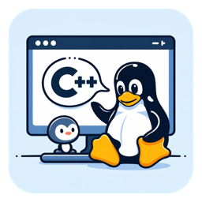

<p align="center">
  
</p>

<h1 align="center">Penguin cpp</h1>

<p align="center"><strong>Un IDE de C/C++ sencillo, libre y nativo para Linux y macOS.</strong></p>

Penguin cpp lleva Embarcadero Dev-C++ a Linux y macOS con Apple Silicon.
Conserva su entorno ligero para aprender C y C++, con una interfaz nativa.
El IDE no necesita Wine; el modo opcional de compatibilidad lo utiliza para
ejecutar programas compilados para Windows.

> **Estado: versión 0.5.0.** El IDE funciona en Linux Mint (paquete `.deb` y
> repositorio APT, amd64) y en macOS 26 o posterior con Apple Silicon
> (en pruebas). Hay `.pkg` y `.dmg` completos con el entorno Windows, además
> del DMG nativo. Ver [ROADMAP.md](ROADMAP.md).

---

## Objetivo

Penguin cpp tiene **propósitos educativos y de divulgación**:

- **Para aprender y enseñar.** Estudiantes, docentes, talleres y cursos
  tienen en Linux la misma herramienta que se usa en muchas aulas con
  Windows. Se instala y se usa sin configuraciones complicadas.
- **Para divulgar.** Muestra que un IDE clásico de Windows puede pasar a
  Linux como software libre, y documenta cómo se hizo: cada fase del port
  está explicada en [ROADMAP.md](ROADMAP.md) y en el historial de commits.
- **Distribución:** paquete `.deb` y repositorio APT para Debian, Ubuntu,
  Linux Mint y derivadas; `.app`/`.dmg` para macOS 26+ con Apple Silicon.
  `.pkg` y `.dmg` completos experimentales, con fuentes y avisos de sus dependencias.

---

## Qué ofrece

Funciones disponibles:

- Editor con resaltado de sintaxis de C/C++, temas de color y numeración de
  líneas.
- Navegador de clases y autocompletado, con un analizador de C++ propio.
- Proyectos y plantillas (consola, bibliotecas…).
- Compilación con gcc/g++ en Linux y clang en macOS, con errores que llevan
  a su línea en el editor.
- Depuración nativa con gdb en Linux y lldb-dap en macOS; adjuntar a un
  proceso nativo desde el menú Ejecutar.
- Formateo de código con AStyle o clang-format.
- Traducida a más de 30 idiomas, incluido el español (con variantes de
  España y Colombia).

- Buscar e instalar actualizaciones del IDE desde el menú Ayuda.
- Compatibilidad Windows experimental, con modos Automático/Nativo/Windows,
  compilador cruzado y ejecución mediante Wine cuando el entorno está disponible.

Qué funciona hoy y qué falta está en [ROADMAP.md](ROADMAP.md).

---

## Instalación

El [manual](https://juanfrang.github.io/Penguin-cpp/manual/) explica cómo
usarlo, en español y en inglés; también se abre desde el IDE con F1.

Penguin cpp se instala con `apt` en Debian, Ubuntu, Linux Mint y derivadas
(amd64). `apt` instala también todo lo que necesita: gcc, g++, make, gdb,
astyle y clang-format. En amd64 también resuelve las dependencias de MinGW
y Wine para el modo Windows.

Una sola vez, agrega su repositorio y la clave con la que está firmado:

```bash
curl -fsSL https://juanfrang.github.io/Penguin-cpp/penguin-cpp.gpg | sudo tee /usr/share/keyrings/penguin-cpp.gpg > /dev/null
echo "deb [signed-by=/usr/share/keyrings/penguin-cpp.gpg] https://juanfrang.github.io/Penguin-cpp stable main" | sudo tee /etc/apt/sources.list.d/penguin-cpp.list
sudo apt update
```

Después se instala como cualquier programa, y las versiones nuevas llegan con
`sudo apt upgrade`:

```bash
sudo apt install penguin-cpp
```

También se puede descargar el `.deb` de
[Releases](https://github.com/JuanFranG/Penguin-cpp/releases) e instalarlo
directamente (sin agregar el repositorio APT):

```bash
sudo apt install ./penguin-cpp_0.5.0_amd64.deb
```

Después aparece en el menú, en *Programación* y *Educación*. También se abre
desde una terminal con `penguin-cpp`, y `man penguin-cpp` explica sus opciones.

Para desinstalarlo:

```bash
sudo apt remove penguin-cpp
```

La configuración de cada usuario queda en `~/.config/penguin-cpp` y sus
plantillas en `~/.local/share/penguin-cpp`; se pueden borrar a mano. Si el IDE
tiene un error, lo anota en `penguin-cpp-errores.txt`, en el Escritorio.

### macOS 26 o posterior (Apple Silicon)

Para incluir las herramientas Windows, descarga el [PKG completo 0.5.0](https://github.com/JuanFranG/Penguin-cpp/releases/download/v0.5.0/Penguin-cpp-0.5.0-COMPLETE-UNSIGNED.pkg). Incluye LLVM-MinGW, GNU Make y Wine ARM64/FEX dentro de la app. También está disponible el [DMG completo](https://github.com/JuanFranG/Penguin-cpp/releases/download/v0.5.0/Penguin-cpp-0.5.0-COMPLETE-UNSIGNED.dmg). Son experimentales y no tienen firma Developer ID ni notarización.

Para una instalación nueva **solo del IDE nativo**, esta línea descarga la última versión, la pone en Aplicaciones y,
si faltan, pide las Command Line Tools de Apple (clang, make y lldb):

```bash
curl -fsSL https://juanfrang.github.io/Penguin-cpp/install-macos.sh | bash
```

También se puede descargar el DMG nativo `Penguin-cpp-0.5.0-arm64.dmg` de
[Releases](https://github.com/JuanFranG/Penguin-cpp/releases/latest) y
arrastrar *Penguin cpp* a Aplicaciones; como la app no está firmada por un
desarrollador de Apple, la primera vez hay que abrirla, cerrar el aviso y
pulsar *Abrir igualmente* en *Configuración del Sistema > Privacidad y
seguridad*.

El formateador de código (astyle) viene dentro de la app. La configuración
queda en `~/Library/Application Support/penguin-cpp`. El DMG nativo incluye
el IDE nativo y su integración de compatibilidad, **pero no incluye el
compilador Windows ni el motor Wine/FEX completos**.

El `.pkg` completo instala LLVM-MinGW, GNU Make y el motor
ARM64/FEX dentro de la app. Al abrirla, también desde Terminal, Penguin prepara
un entorno privado, compila y ejecuta una prueba y muestra «Entorno listo».
No pide rutas; las instalaciones personalizadas quedan en Opciones avanzadas.
No depende de Rosetta. Las [fuentes correspondientes](https://github.com/JuanFranG/Penguin-cpp/releases/download/v0.5.0/Penguin-cpp-0.5.0-COMPAT-SOURCES.tar.gz), recetas y avisos acompañan al perfil revisado; se excluyen componentes propietarios opcionales y el host anticheat sin licencia identificada. Ver [revisión y exclusiones](Compat/REDISTRIBUTION.md).
Ver [validación y límites](packaging/QA-pkg-macos.md).

| Archivo | Herramientas Windows incluidas | Disponibilidad |
|---|---|---|
| `Penguin-cpp-0.5.0-arm64.dmg` | No; IDE nativo | GitHub Releases |
| `Penguin-cpp-0.5.0-COMPLETE-UNSIGNED.pkg` | Sí: LLVM-MinGW, GNU Make y Wine ARM64/FEX | GitHub Releases (experimental) |
| `Penguin-cpp-0.5.0-COMPLETE-UNSIGNED.dmg` | Sí: el mismo entorno del PKG completo | GitHub Releases (experimental) |


Con el `.pkg` completo descargado, la instalación desde Terminal es:

```bash
sudo installer -pkg /ruta/al/paquete-completo.pkg -target /
open -a "Penguin cpp"
# También se puede iniciar directamente:
"/Applications/Penguin cpp.app/Contents/MacOS/penguin-cpp"
```

Cierra Penguin antes de instalar o actualizar. La preparación se ejecuta con
el usuario que abre la aplicación; Installer no inicia Wine como root. Las
Command Line Tools siguen siendo necesarias para el desarrollo nativo macOS.

Para desinstalar en macOS, cierra Penguin y mueve **Penguin cpp.app** a la
Papelera: las herramientas incluidas se eliminan con la app. La configuración
y el entorno Windows permanecen en `~/Library/Application Support/penguin-cpp`.
Borrar también esa carpeta elimina los programas y datos guardados dentro
del entorno Windows.

### Buscar e instalar actualizaciones

En **Ayuda → Buscar actualizaciones…**, el IDE consulta la última versión
estable publicada en GitHub. Si es más reciente, aparece **Actualizar ahora**.
Antes de cerrar, pide guardar los documentos; **Cancelar** conserva el editor
abierto y cancela la actualización.

En macOS descarga el `.dmg`, verifica la integridad de la app, prepara la copia
nueva antes de reemplazar la anterior y vuelve a abrirla. El progreso aparece
en Terminal. La carpeta de instalación debe permitir escritura; la app sigue
sin firma Developer ID ni notarización. Desde la 0.5.0, el instalador rechaza
reemplazar una copia con entorno Windows completo por un DMG nativo sin ese
entorno. El nuevo paquete completo selecciona el DMG `COMPLETE-UNSIGNED` al actualizar; la edición nativa selecciona el DMG nativo. Se verificó con pruebas simuladas; falta probar una actualización real a una versión futura. Para pasar de una copia nativa o una integración local anterior de la misma 0.5.0, instala el nuevo PKG una vez: el buscador no ofrece de nuevo la misma versión.

En Linux el botón ejecuta `sudo apt-get update` y
`sudo apt-get install --only-upgrade -y penguin-cpp` en una terminal y pide
la contraseña de administración. Necesita APT y el repositorio de Penguin cpp
configurado. Para otras instalaciones está **Abrir descargas**.

Esta función está disponible desde la versión 0.3.0; una versión anterior
que todavía no tenga el menú necesita instalar esa primera actualización
mediante el instalador habitual.

## Últimas versiones y límites

| Versión | Cambios principales |
|---|---|
| [0.3.0](https://github.com/JuanFranG/Penguin-cpp/releases/tag/v0.3.0) | Buscar/instalar actualizaciones, adjuntar a procesos nativos, corrección de colisiones de objetos y sustitución de la app con recuperación ante fallos. |
| [0.4.0](RELEASE_NOTES_0.4.0.md) | Corrección de repintado Cocoa, barras que aprovechan el ancho de la ventana, modos de compatibilidad Windows y herramientas de empaquetado completo. |
| [0.5.0](RELEASE_NOTES_0.5.0.md) | Estado del entorno sin rutas obligatorias, `.pkg` completo por defecto, comprobación al arrancar desde Terminal y protección contra actualizaciones incompletas. |

La compatibilidad Windows es experimental. `windows.h`, `conio.h`, `math.h`
y `stdlib.h` se usan mediante el compilador Windows; eso no convierte todas
las APIs o bibliotecas Windows en bibliotecas nativas de macOS/Linux.
`graphics.h`/WinBGIm no está integrado automáticamente; el prototipo SDL/Metal
es limitado y separado. Tampoco se han implementado la depuración y el
perfilado de programas Windows. Más detalles en [el estado del modo Windows](Compat/WINDOWS-MODE.md).

## Compilar desde el código

Necesitas Lazarus 3.0 o superior y Free Pascal 3.2.2 (Linux Mint 22 /
Ubuntu 24.04):

```bash
sudo apt install lazarus fpc g++ gdb make git python3 lcl-qt5-3.0 libqt5pas-dev
git clone https://github.com/JuanFranG/Penguin-cpp.git
cd Penguin-cpp
lazbuild -B --ws=qt5 Source/penguin-cpp.lpi
./penguin-cpp
```

Para armar el paquete `.deb` (queda en `build/deb/`):

```bash
sudo apt install dpkg-dev lintian
packaging/build-deb.sh
```

En macOS hacen falta Free Pascal 3.2.4 y Lazarus 3.8 (Free Pascal 3.2.2 no
puede enlazar programas Cocoa con el enlazador actual de Apple). La app y el
`.dmg` quedan en `build/macos/`:

```bash
LAZBUILD="ruta/a/lazbuild --lazarusdir=ruta/a/lazarus --compiler=ruta/a/fpc" packaging/build-macos.sh
```

Las pruebas y más detalles están en [ROADMAP.md](ROADMAP.md#cómo-compilar-y-probar-linux).

---

## Autor

**Juan Francisco Gonzalez Pacheco**: Ingeniería de Sistemas, Universidad
del Magdalena.

El proyecto se ha desarrollado con la asistencia de modelos de inteligencia
artificial: **Claude Opus 5.5**, de Anthropic, y **Chat GPT 6.1 Sol**, de
OpenAI. Esta asistencia ha acompañado el trabajo de portabilidad, revisión,
pruebas, empaquetado y documentación; la autoría y las decisiones del proyecto
corresponden a Juan Francisco Gonzalez Pacheco.

## Origen

Penguin cpp parte del código de **Embarcadero Dev-C++**
(<https://github.com/Embarcadero/Dev-Cpp>), que a su vez continúa a
**Orwell Dev-C++** y a **Bloodshed Dev-C++**
(<https://www.bloodshed.net/devcpp.html>). El proyecto original solo funciona
en Windows y está hecho con Delphi.

Para llevarlo a Linux y macOS se pasó a **Lazarus y Free Pascal** y se
sustituyeron las dependencias exclusivas de Windows del IDE. El historial
completo del proyecto original se conserva en este repositorio. Sus notas de versión están en
[NEWS.txt](NEWS.txt).

## Licencia

Penguin cpp es software libre bajo la **GNU General Public License, versión 2
o posterior** ([LICENSE](LICENSE)), la misma licencia del código del que
parte.

## Créditos

- **Bloodshed Dev-C++**: Colin Laplace y colaboradores.
- **Orwell Dev-C++**: Johan Mes y colaboradores.
- **Embarcadero Dev-C++**: Embarcadero Technologies y colaboradores.
- [Lazarus](https://www.lazarus-ide.org/) y [Free Pascal](https://www.freepascal.org/):
  la LCL y el componente de edición SynEdit.
- [Artistic Style](https://astyle.sourceforge.net/): formateo de código.
- Temas [Monokai](https://github.com/rbardini/devcpp-monokai) y
  [Monokai Fresh](https://github.com/sspathare97/devcpp-monokai_fresh).
- Fuentes Heebo y Source Code Pro (SIL Open Font License).

## Aviso sobre marcas

Penguin cpp es un proyecto independiente. **No está afiliado a Embarcadero
Technologies ni cuenta con su respaldo.** "Embarcadero" y "Delphi" son marcas
registradas de sus dueños. Aquí se nombran solo para indicar de dónde viene
el código.
