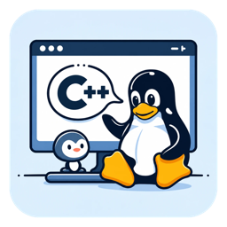

<p align="center">
  
</p>

<h1 align="center">Penguin cpp</h1>

<p align="center"><strong>Un IDE de C/C++ sencillo, libre y nativo para Linux.</strong></p>

Penguin cpp expande Embarcadero Dev-C++ a Linux. Es el mismo entorno ligero
con el que mucha gente aprende C y C++, ahora como programa nativo de Linux,
sin Wine.

> **Estado: en desarrollo.** Todavía no hay una versión instalable. El IDE ya
> compila con Lazarus y está en su primera fase de pruebas en Linux Mint. Ver
> [ROADMAP.md](ROADMAP.md).

---

## Objetivo

Penguin cpp tiene **propósitos educativos y de divulgación**:

- **Para aprender y enseñar.** Estudiantes, docentes, talleres y cursos
  tienen en Linux la misma herramienta que se usa en muchas aulas con
  Windows. Se instala y se usa sin configuraciones complicadas.
- **Para divulgar.** Muestra que un IDE clásico de Windows puede pasar a
  Linux como software libre, y documenta cómo se hizo: cada fase del port
  está explicada en [ROADMAP.md](ROADMAP.md) y en el historial de commits.
- **Producto final: un paquete `.deb`** para Debian, Ubuntu, Linux Mint y
  derivadas. Se instala con `apt`, trae sus dependencias (gcc/g++, gdb,
  make) y aparece en el menú de aplicaciones.

---

## Qué ofrece

Lo que trae del Dev-C++ original y se está portando:

- Editor con resaltado de sintaxis de C/C++, temas de color y numeración de
  líneas.
- Navegador de clases y autocompletado, con un analizador de C++ propio.
- Proyectos y plantillas (consola, bibliotecas…).
- Compilación con el gcc/g++ del sistema, con errores que se pueden clicar.
- Depuración con gdb.
- Formateo de código con AStyle o clang-format.
- Traducida a más de 30 idiomas, incluido el español (con variantes de
  España y Colombia).

Qué funciona hoy y qué falta está en [ROADMAP.md](ROADMAP.md).

---

## Instalación

Cuando exista la primera versión, el `.deb` se publicará en
[Releases](https://github.com/JuanFranG/Penguin-cpp/releases) y se instalará
así:

```bash
sudo apt install ./penguin-cpp_<versión>_amd64.deb
```

## Compilar desde el código

Necesitas Lazarus 3.0 o superior y Free Pascal 3.2.2 (Linux Mint 22 /
Ubuntu 24.04):

```bash
sudo apt install lazarus fpc g++ gdb make git python3
git clone https://github.com/JuanFranG/Penguin-cpp.git
cd Penguin-cpp
lazbuild --ws=gtk2 Source/penguin-cpp.lpi
./penguin-cpp
```

Las pruebas y más detalles están en [ROADMAP.md](ROADMAP.md#cómo-compilar-y-probar-linux).

---

## Origen

Penguin cpp parte del código de **Embarcadero Dev-C++**
(<https://github.com/Embarcadero/Dev-Cpp>), que a su vez continúa a
**Orwell Dev-C++** y a **Bloodshed Dev-C++**
(<https://www.bloodshed.net/devcpp.html>). El proyecto original solo funciona
en Windows y está hecho con Delphi.

Para llevarlo a Linux se pasó a **Lazarus y Free Pascal**, y se quitó todo lo
que solo existe en Windows. El historial completo del proyecto original se
conserva en este repositorio. Sus notas de versión están en
[NEWS.txt](NEWS.txt).

## Licencia

Penguin cpp es software libre bajo la **GNU General Public License, versión 2
o posterior** ([LICENSE](LICENSE)), la misma licencia del código del que
parte.

## Créditos

- **Bloodshed Dev-C++**: Colin Laplace y colaboradores.
- **Orwell Dev-C++**: Johan Mes y colaboradores.
- **Embarcadero Dev-C++**: Embarcadero Technologies y colaboradores.
- [Lazarus](https://www.lazarus-ide.org/) y [Free Pascal](https://www.freepascal.org/):
  la LCL y el componente de edición SynEdit.
- [Artistic Style](https://astyle.sourceforge.net/): formateo de código.
- Temas [Monokai](https://github.com/rbardini/devcpp-monokai) y
  [Monokai Fresh](https://github.com/sspathare97/devcpp-monokai_fresh).
- Fuentes Heebo y Source Code Pro (SIL Open Font License).

## Aviso sobre marcas

Penguin cpp es un proyecto independiente. **No está afiliado a Embarcadero
Technologies ni cuenta con su respaldo.** "Embarcadero" y "Delphi" son marcas
registradas de sus dueños. Aquí se nombran solo para indicar de dónde viene
el código.
